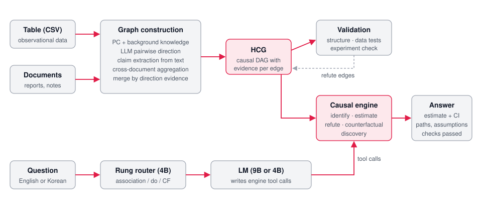

# hvme

**검증할 수 있는 인과 그래프, 도구를 쓰는 인과 추론 LLM, 기호 인과 엔진을 오케스트레이터와 MCP 서버 하나로 묶는다.**

[English](README.md) · [한국어](README.ko.md)

> 상태: v0.1.0 첫 공개판이다. 모델 가중치는 Hugging Face에 있다([모델](#모델)).

hvme은 표와 문서를 인과 DAG(HCG, *Hvme Causal Graph*)로 바꾸고, 그 DAG를 데이터로 검사한다. 인과 질문에는 언어 모델의 짐작이 아니라 기호 엔진이 계산한 수치로 답한다. 작은 LLM은 질문을 엔진 호출로 옮기고 결과를 읽어 답하도록 학습했다. 단일 패스 판정 모델은 쉬운 질문을 처리하고 확신도를 보정한다.

## 무엇이 다른가

일반 LLM에게 "광고비를 늘리면 매출이 오르는가?"라고 물으면 매끄럽지만 수치도 검증도 없는 답이 나온다. hvme은 같은 질문에 이렇게 답한다.

1. 데이터와 문서로 그래프를 만든다. 엣지마다 근거(데이터 검정, 텍스트, LLM 사전지식)가 붙는다.
2. 그래프를 데이터로 검사한다(국소 마르코프 조건, 순열 검정, 엣지 검정).
3. 효과를 식별하고(백도어, 프론트도어, 도구변수, ID 알고리즘) 부트스트랩 구간과 함께 추정한다.
4. 반박 검사를 돌리고, 실험 데이터가 있으면 추정값과 맞대 본다.
5. 인과 경로와 기댄 가정을 함께 설명한다.

```
strategy: backdoor
answer:   광고비를 1로 바꾸면 매출=1일 확률이 +0.211 (95% 구간 +0.185 ~ +0.241)만큼 달라진다. 즉 광고비는 매출을 높인다.
```
(`examples/01_quickstart.py` 출력)

## 설치

```bash
pip install hvme                 # 핵심: 그래프, 엔진, 검증, Gym (CPU)
pip install "hvme[mcp]"          # MCP 서버(hvme-mcp)
pip install "hvme[hf]"           # 로컬 Hugging Face 모델(torch, transformers)
pip install "hvme[vllm]"         # vLLM 같은 OpenAI 호환 서버 클라이언트
pip install "hvme[bench]"        # 벤치마크 추가 의존성(pgmpy)
```

소스에서 설치하려면 다음과 같이 한다.

```bash
git clone https://github.com/namuax/hvme && cd hvme
pip install -e ".[dev,mcp,bench]"
pytest -q --ignore=tests/test_fast_torch.py
```

데이터·모델·결과는 `HVME_HOME` 아래에 둔다(기본은 저장소 루트).

## 빠른 시작

GPU와 LLM 없이 돈다. 알려진 DAG에서 합성 마케팅 시나리오(관측 데이터, 실험 데이터, 문서 12개)를 만들고, LLM 대신 정답 코퍼스를 아는 가상 LLM을 쓴다.

```bash
HVME_HOME=./hvme_work python examples/01_quickstart.py
```

```python
from hvme import api

api.validate_run("marketing", "data.csv")                               # 그래프가 데이터와 맞는가
api.engine_identify("marketing", "ad_spend", "sales", "data.csv")       # -> backdoor
api.engine_estimate("marketing", "data.csv", "ad_spend", "sales")       # ATE와 부트스트랩 구간
api.engine_counterfactual("marketing", "data.csv", "ad_spend", "sales", "nie", ["web_traffic"])
api.ask("광고비를 늘리면 매출이 오르는가?", "marketing", "data.csv")
```

예제: [`01_quickstart.py`](examples/01_quickstart.py)(전 과정, GPU 없음) · [`02_graph_from_table.py`](examples/02_graph_from_table.py) · [`03_gym_generate.py`](examples/03_gym_generate.py) · [MCP 설정](examples/04_mcp_server.md) · [vLLM 서빙](examples/05_serve_vllm.md)

MCP 서버(도구 17개)는 `hvme-mcp`로 띄운다. LLM은 vLLM으로 서빙하고 `HVME_LM_URL`로 가리킨다.

## 결과

직접 잰 값이고 원 수치는 [`bench/`](bench/)에 있다. 9B는 Qwen3.5-9B를 엔진으로 검증한 도구 궤적으로 LoRA 학습한 모델이다(tool 모드: 모델이 엔진을 부른다). 기반 모델은 도구 없이 답한다.

| 벤치마크 | 기반 Qwen3.5-9B(도구 없음) | hvme 9B |
|---|---|---|
| CaLM-lite(영어 45과제 × 30) | 51.0 | **91.5** |
| CauGym(6셋 × 7유형 × 15) | 31.3 | **75.6** |
| 목표 지표(위 둘의 평균) | 41.1 | **83.6** |
| CLadder 150(기반: CausalCoT 8k, hvme: tool 모드) | 86.7 | **90.7** |
| Corr2Cause(300, F1) | — | **0.923** |
| KoCLadder(528, 한국어 기계 번역) | — | 0.758(같은 문항 영어 0.907) |
| KoCorr2Cause(1,157, 한국어 기계 번역) | — | 0.963 |

일반 능력은 유지된다. MATH-500과 KMMLU는 기반 모델과 1pt 안팎 차이다. 단일 패스 판정 모델(Qwen3.5-4B, 보정)은 CLadder 600 0.843, CauGym 예/아니오 2,500 0.751이다. Rung 라우터는 CLadder Rung 0.992, KoCLadder Rung 0.983이다.

주의할 점이 있다. 한국어 셋은 자동 검사(숫자, 역번역 극성, 비교 순서)를 통과한 기계 번역이고 아직 사람이 검수하지 않았다. 한 번씩 학습한 모델끼리는 CLadder 150에서 8문항, KMMLU에서 2pt까지 차이가 나니 그보다 작은 차이는 잡음이다.

## 구성



자세한 설명(영어): [아키텍처](docs/architecture.md) · [HCG 형식](docs/hcg.md) · [엔진](docs/engine.md) · [LM 도구](docs/tools.md) · [학습](docs/training.md) · [평가](docs/evaluation.md)

| 패키지 | 역할 |
|---|---|
| `hvme.graph` | HCG 스키마, 표 → HCG(배경지식 PC, LLM 쌍별 방향, 부트스트랩), 텍스트 → HCG(추출, 정규화, 문서 간 집계) |
| `hvme.validate` | DAG 검사: 사이클·시간 순서, 조건부 독립 검정, 순열 검정, 엣지 검정, 실험 대조 |
| `hvme.engine` | d-분리, 식별(백도어, O-set, 프론트도어, 도구변수, ID), 이진·선형 SCM, 추정, 반박, 마르코프 동치류 인과 발견 |
| `hvme.gym` | 정답을 엔진이 계산하는 질문 생성기(연관, 개입, 반사실, 구조), 영어·한국어 |
| `hvme.lm` | 도구 정의, 궤적, SFT·GRPO 학습, 엔진 호출 샘플링 |
| `hvme.fast` | 단일 패스 판정(예/아니오, 선택, 점수), 온도 보정, 확신이 낮을 때 큰 모델로 넘기는 라우터 |
| `hvme.orchestrator` | 질문 분석 → 그래프 → 검증 → 식별 → 추정 → 반박 → 설명 |
| `hvme.mcp`, `hvme.api` | MCP 서버와 그 밑의 경로 기반 API |
| `skills/` | MCP 도구 위에 만든 에이전트 Skill 9종 |

## 모델

| 모델 | 기반 | 쓰임 | Hugging Face |
|---|---|---|---|
| hvme LM 9B | Qwen3.5-9B | 주 추론 모델(tool 모드) | [`namuax/hvme-lm-9b`](https://huggingface.co/namuax/hvme-lm-9b) |
| hvme LM 4B | Qwen3.5-4B | 가벼운 모델 | [`namuax/hvme-lm-4b`](https://huggingface.co/namuax/hvme-lm-4b) |
| hvme Fast 4B | Qwen3.5-4B | 단일 패스 판정 | [`namuax/hvme-fast-4b`](https://huggingface.co/namuax/hvme-fast-4b) |
| hvme Router 4B | Qwen3.5-4B | Rung 분류(영어·한국어) | [`namuax/hvme-router-4b`](https://huggingface.co/namuax/hvme-router-4b) |

`api.ask_v1`, `fast_*`, `classify_question`, `lm_verify`를 뺀 나머지는 가중치 없이도 돈다.

## 재현

- 벤치마크는 다시 배포하지 않는다. `hvme.bench.datasets`가 CLadder, Corr2Cause, CauGym, MATH-500, KMMLU를 원 출처에서 내려받는다.
- 학습 문항은 Gym 생성기(`hvme.gym`)에서 만들고 정답은 모두 엔진이 계산한다. 벤치 문항은 학습에 쓰지 않는다.
- `notebooks/01–09`는 스키마, 엔진, Gym, 검증, 그래프 구축, 단일 패스 판정을 차례로 다룬다. 출력 없이 저장돼 있다.

## 한계

- 엔진은 이진·선형 SCM을 다룬다. 다른 메커니즘에는 다른 추정기가 필요하다.
- 자유 형식 지문을 엔진 인자로 옮기지 못하는 경우가 남아 있다(CLadder·CauGym 남은 오답의 다수는 답 없음).
- 한국어는 KoCLadder에서 영어보다 15pt쯤 낮다.
- 텍스트로 만든 그래프는 추출 LLM에 기댄다. LLM 사전지식만 지지하는 엣지는 따로 표시되니 확인해야 한다.

## 라이선스

코드는 [Apache License 2.0](LICENSE)으로 공개한다. 모델 가중치는 기반 모델인 Qwen3.5의 라이선스도 함께 따른다.
