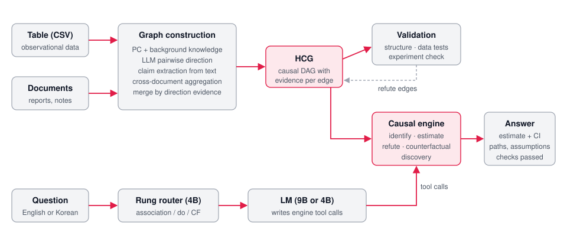

# humm

**Verifiable causal graphs + a tool-using causal reasoning LLM + a symbolic causal engine, behind one orchestrator and an MCP server.**

[English](README.md) · [한국어](README.ko.md)

> Status: v0.1.0, private preview. Model weights are not published yet (see [Models](#models)).

humm turns tables and documents into a causal DAG (HCG, *Humm Causal Graph*), checks the DAG against the data, and answers causal questions with numbers that come from a symbolic engine rather than from the language model's guess. A small LLM is trained to translate a question into engine calls and to read the result back; a single-pass judge routes easy questions and calibrates confidence.

## What is different

Ask a plain LLM "If we raise the ad budget, do sales go up?" and you get a fluent answer with no number and no check. humm answers the same question like this:

1. builds a graph from the data and the documents (every edge carries its evidence: data test, text, LLM prior),
2. tests the graph against the data (local Markov conditions, permutation test, edge tests),
3. identifies the effect (backdoor / front-door / IV / ID algorithm) and estimates it with a bootstrap interval,
4. runs refutation tests and, if an experiment exists, checks the estimate against it,
5. explains the answer with the causal paths and the assumptions it relied on.

```
strategy: backdoor
answer:   광고비를 1로 바꾸면 매출=1일 확률이 +0.211 (95% 구간 +0.185 ~ +0.241)만큼 달라진다. 즉 광고비는 매출을 높인다.
```
(output of `examples/01_quickstart.py`; the demo scenario is in Korean, English questions work the same way)

## Install

```bash
pip install humm                 # core: graph, engine, validation, Gym (CPU only)
pip install "humm[mcp]"          # MCP server (humm-mcp)
pip install "humm[hf]"           # local Hugging Face models (torch, transformers)
pip install "humm[vllm]"         # client for an OpenAI-compatible server such as vLLM
pip install "humm[bench]"        # benchmark extras (pgmpy)
```

From source:

```bash
git clone https://github.com/no-wave/humm && cd humm
pip install -e ".[dev,mcp,bench]"
pytest -q --ignore=tests/test_fast_torch.py
```

Data, models and results live under `HUMM_HOME` (default: the repository root).

## Quick start

No GPU and no LLM needed. The example generates a synthetic marketing scenario (observational data, an experiment and twelve documents from a known DAG) and uses a text oracle in place of the LLM:

```bash
HUMM_HOME=./humm_work python examples/01_quickstart.py
```

```python
from humm import api

api.validate_run("marketing", "data.csv")                               # does the graph survive the data?
api.engine_identify("marketing", "ad_spend", "sales", "data.csv")       # -> backdoor
api.engine_estimate("marketing", "data.csv", "ad_spend", "sales")       # ATE with a bootstrap CI
api.engine_counterfactual("marketing", "data.csv", "ad_spend", "sales", "nie", ["web_traffic"])
api.ask("광고비를 늘리면 매출이 오르는가?", "marketing", "data.csv")
```

Examples: [`01_quickstart.py`](examples/01_quickstart.py) (full chain, no GPU) · [`02_graph_from_table.py`](examples/02_graph_from_table.py) · [`03_gym_generate.py`](examples/03_gym_generate.py) · [MCP setup](examples/04_mcp_server.md) · [vLLM serving](examples/05_serve_vllm.md)

MCP server (17 tools: `graph_*`, `validate_run`, `engine_*`, `ask`, `fast_*`, `classify_question`, `lm_verify`, `ask_v1`):

```bash
humm-mcp
```

Serving the LLM with vLLM and pointing humm at it:

```bash
vllm serve <model> --served-model-name humm-lm --port 8011
HUMM_LM_URL=http://127.0.0.1:8011/v1 HUMM_LM=<model> python -c "from humm import api; print(api.ask_v1('...', 'marketing', 'data.csv'))"
```

## Results

Measured on our own runs; the raw numbers are in [`bench/`](bench/). The 9B model is Qwen3.5-9B fine-tuned with LoRA on engine-verified tool trajectories (tool mode: the model calls the engine). The base model answers without tools.

| Benchmark | Base Qwen3.5-9B (no tools) | humm 9B |
|---|---|---|
| CaLM-lite (45 English tasks × 30) | 51.0 | **91.5** |
| CauGym (6 sets × 7 types × 15) | 31.3 | **75.6** |
| Target metric (mean of the two above) | 41.1 | **83.6** |
| CLadder 150 (base: CausalCoT 8k, humm: tool mode) | 86.7 | **90.7** |
| Corr2Cause (300, F1) | — | **0.923** |
| KoCLadder (528, Korean, machine-translated) | — | 0.758 (English same items 0.907) |
| KoCorr2Cause (1,157, Korean, machine-translated) | — | 0.963 |

Single-pass judge (Qwen3.5-4B, one forward pass, calibrated): CLadder 600 0.843, CauGym yes/no 2,500 0.751. Rung router: CLadder Rung 0.992, KoCLadder Rung 0.983.

General ability is kept: MATH-500 and KMMLU stay within about 1 point of the base model.

Caveats: the Korean sets are machine translations that passed automatic checks (numbers, back-translation polarity, comparison order) and have not been reviewed by people yet. Single training runs differ by up to about 8 items on CLadder 150 and 2 points on KMMLU; smaller gaps are noise.

## How it works



More: [architecture](docs/architecture.md) · [HCG format](docs/hcg.md) · [engine](docs/engine.md) · [LM tools](docs/tools.md) · [training](docs/training.md) · [evaluation](docs/evaluation.md)

| Package | Role |
|---|---|
| `humm.graph` | HCG schema; table → HCG (PC with background knowledge, LLM pairwise direction, bootstrap); text → HCG (extraction, normalisation, cross-document aggregation) |
| `humm.validate` | DAG checks: cycles and time order, conditional-independence tests, permutation test, edge tests, experiment comparison |
| `humm.engine` | d-separation, identification (backdoor, O-set, front-door, IV, ID), binary and linear SCMs, estimation, refutation, causal discovery over Markov equivalence classes |
| `humm.gym` | Question generator whose answers are computed by the engine (associational, interventional, counterfactual, structural), English and Korean |
| `humm.lm` | Tool definitions, trajectories, SFT/GRPO training, sampling with engine calls |
| `humm.fast` | Single-pass judge (yes/no, choice, score), temperature calibration, routing to a larger model when unsure |
| `humm.orchestrator` | Question analysis → graph → validation → identification → estimation → refutation → explanation |
| `humm.mcp`, `humm.api` | MCP server and the path-based API it wraps |
| `skills/` | Nine agent skills built on the MCP tools |

## Models

| Model | Base | Use | Hugging Face |
|---|---|---|---|
| humm LM 9B | Qwen3.5-9B | main reasoning model (tool mode) | to be published |
| humm LM 4B | Qwen3.5-4B | light model | to be published |
| humm Fast 4B | Qwen3.5-4B | single-pass judge | to be published |
| humm Router 4B | Qwen3.5-4B | Rung classifier (English and Korean) | to be published |

Until the weights are published, everything except `api.ask_v1`, `fast_*`, `classify_question` and `lm_verify` runs without them.

## Reproducing

- Benchmarks are not redistributed. `humm.bench.datasets` downloads CLadder, Corr2Cause, CauGym, MATH-500 and KMMLU from their original sources.
- Training questions come from the Gym generators (`humm.gym`), so every label is computed by the engine. Benchmark items are never used for training.
- Notebooks `notebooks/01–09` walk through the schema, engine, Gym, validation, graph construction and the single-pass judge. They are stored without outputs.

## Limitations

- The engine works on binary and linear SCMs. Other mechanisms need a different estimator.
- The LM still fails to translate some free-form passages into engine arguments (most remaining CLadder and CauGym errors are "no answer").
- Korean performance trails English by about 15 points on KoCLadder.
- Graphs from text depend on the extraction LLM. Edges that only an LLM prior supports are marked as such and should be checked.

## License

Code is released under the [Apache License 2.0](LICENSE). Model weights, once published, also follow the license of their Qwen3.5 base models.
